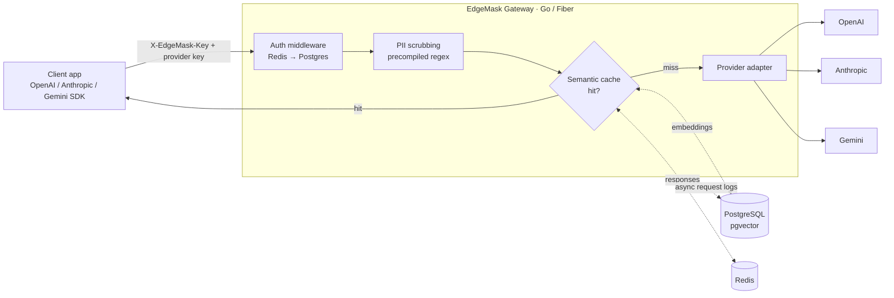

<div align="center">

# 🛡️ EdgeMask Backend

**A zero-trust security & cost gateway for LLM APIs, written in Go.**

EdgeMask sits between your application and OpenAI / Anthropic / Gemini. It redacts PII and secrets before they leave your network, and it answers semantically similar prompts from a vector cache instead of paying for them twice.

[](https://go.dev)
[](https://gofiber.io)
[](https://github.com/pgvector/pgvector)
[](https://redis.io)
[](#-running-with-docker)
[](#-api-reference)

[Live product](https://edgemask.pro) · [Architecture](#-architecture) · [Quick start](#-quick-start) · [API](#-api-reference)

</div>

---

## Why EdgeMask?

Teams adopting LLMs run into two problems fast:

1. **Data leakage.** Prompts quietly carry emails, phone numbers, card numbers, IBANs, JWTs and cloud keys to a third-party API.
2. **Paying twice for the same question.** "How do I reset my password?" and "I forgot my password, what now?" are the same request, but each one is a billable round trip.

EdgeMask fixes both **with a one-line change**. You point your SDK's `baseURL` at EdgeMask and leave the rest of your code alone.

```diff
  const client = new OpenAI({
-   baseURL: "https://api.openai.com/v1",
+   baseURL: "https://<your-edgemask-host>/v1/proxy/openai",
+   defaultHeaders: { "X-EdgeMask-Key": process.env.EDGEMASK_KEY },
  });
```

## ✨ Features

| | |
|---|---|
| 🔒 **PII & secret redaction** | 16 built-in rules (JWT, AWS keys, GitHub/Stripe/Slack tokens, IBAN, credit card, email, phone, IPv4, MAC, DOB, SSN, passport, ETH wallet, …). Only `messages[].content` is rewritten. Every other byte of the request body is left untouched. |
| ⚡ **Sub-millisecond scrubbing** | Regex rules are compiled **once at startup**, not per request. Specific patterns (secrets, tokens) run before generic ones (SSN, card numbers) to keep false positives low. |
| 🧠 **Semantic cache** | Prompts are embedded and matched by cosine similarity in **pgvector** (IVFFlat index). Cached responses are served from **Redis**. The similarity threshold, TTL and embedding model are all configurable. |
| 🔌 **One gateway, three providers** | OpenAI, Anthropic and Gemini sit behind a single `/v1/proxy/:provider` endpoint, implemented with the **Adapter pattern**. |
| 🗝️ **Zero-trust BYOK** | EdgeMask **never stores provider keys**. Your `Authorization` header is forwarded to the upstream provider as is. Only `X-EdgeMask-Key` is stripped. |
| 📡 **Streaming support** | SSE (`stream: true`) responses are piped straight through. Upstream headers are forwarded, minus hop-by-hop headers. |
| 📊 **Usage analytics** | Each request is logged asynchronously with provider, model, tokens, latency, PII categories and cache hit or miss. The dashboard API serves aggregate stats and time series. |
| 🔑 **API key management** | `edgemask_live_…` keys are stored as hashes and validated through a **Redis fast path** (5-minute TTL) with a PostgreSQL fallback. Dashboard routes are protected by Supabase **JWT/JWKS**. |

## 🏗 Architecture



### Request lifecycle

1. **Authenticate**: validate `X-EdgeMask-Key` (Redis cache first, then the database).
2. **Scrub**: redact PII inside `messages[].content` and record which categories were found.
3. **Look up**: for non-streaming requests, embed the prompt and search pgvector for the nearest neighbour within the configured similarity. On a hit, return the cached response from Redis.
4. **Forward**: send the sanitized body to the provider adapter, passing your own headers through.
5. **Store**: on a successful 2xx response, write the body to Redis and the embedding to pgvector with a TTL.
6. **Log**: write the request log in a background goroutine so it never adds latency to the response.

### Project layout

The code follows Clean Architecture: domain ← repository / services ← handlers.

```text
.
├── cmd/api/main.go                # Composition root: config, DI, routes, server
├── config/                        # Env-based configuration
├── internal/
│   ├── domain/                    # Entities, interfaces, errors, scrubbing rules
│   ├── handlers/                  # Fiber handlers + auth/dashboard middleware
│   ├── services/                  # proxy, scrubbing, auth, embedding
│   ├── repository/
│   │   ├── postgres/              # keys, request logs, analytics, semantic cache
│   │   └── redis/                 # key cache, semantic response cache
│   └── infrastructure/
│       ├── database/              # Postgres connection + migration runner
│       └── providers/             # OpenAI / Anthropic / Gemini adapters
├── migrations/                    # Versioned SQL migrations (run on startup)
├── docs/                          # Generated Swagger / OpenAPI spec
├── postman/                       # Postman collection
├── pkg/logger/
├── Dockerfile                     # Multi-stage, static binary on Alpine
└── docker-compose*.yml
```

## 🚀 Quick start

### Prerequisites

- Go **1.25+**
- PostgreSQL with the **pgvector** extension (the project targets Supabase Postgres)
- Redis 7+
- A Supabase project (for dashboard JWT auth)

### 1. Configure

```bash
git clone https://github.com/mr-isik/EdgeMask-Backend.git
cd EdgeMask-Backend
cp .env.example .env
```

| Variable | Description | Default |
|---|---|---|
| `PORT` | HTTP port | `3000` |
| `APP_ENV` | `development` \| `production` | `development` |
| `DATABASE_URL` | PostgreSQL connection string (Supabase transaction pooler) | — |
| `REDIS_URL` | Redis URL, e.g. `redis://:password@host:6379/0` or `rediss://…` for TLS | `redis://localhost:6379/0` |
| `API_KEY_SECRET` | Secret used when hashing EdgeMask API keys | — |
| `SUPABASE_URL` | Supabase project URL (JWKS is fetched from it) | — |
| `SUPABASE_ANON_KEY` / `SUPABASE_SERVICE_ROLE_KEY` / `SUPABASE_JWT_SECRET` | Supabase credentials | — |
| `OPENAI_BASE_URL` / `ANTHROPIC_BASE_URL` / `GEMINI_BASE_URL` | Upstream base URLs | official endpoints |
| `SEMANTIC_CACHE_ENABLED` | Toggle the semantic cache | `true` |
| `SEMANTIC_CACHE_TTL_SECONDS` | Cache entry lifetime | `3600` |
| `SEMANTIC_CACHE_SIMILARITY_MIN` | Minimum cosine similarity for a hit | `0.92` |
| `SEMANTIC_CACHE_EMBEDDING_MODEL` | Embedding model | `text-embedding-3-small` |

### 2. Run locally

```bash
make tidy
make run          # go run cmd/api/main.go
```

Migrations in `./migrations` run automatically on startup.

- Health check: `GET http://localhost:3000/health`
- Swagger UI: `http://localhost:3000/swagger/index.html`

### 🐳 Running with Docker

```bash
make docker-up    # regenerates Swagger docs, then builds and starts API + Redis
make docker-logs  # follow API logs
make docker-down
make docker-prod  # production overrides
```

The image is a multi-stage build that produces a static, stripped Go binary on Alpine.

## 📖 API reference

Full, interactive docs are served at **`/swagger/index.html`**. A Postman collection is in [`postman/`](postman/).

| Method | Route | Auth | Description |
|---|---|---|---|
| `GET` | `/health` | – | Service health |
| `POST` | `/v1/proxy/:provider` | `X-EdgeMask-Key` | Proxy to `openai`, `anthropic` or `gemini` (supports SSE) |
| `POST` | `/v1/proxy/:provider/*` | `X-EdgeMask-Key` | SDK-friendly alias (e.g. `…/openai/chat/completions`) that routes to the same chat endpoint |
| `GET` | `/api/keys` | Supabase JWT | List API keys |
| `POST` | `/api/keys` | Supabase JWT | Create an API key |
| `PATCH` | `/api/keys/:id/revoke` | Supabase JWT | Revoke an API key |
| `GET` | `/api/stats` | Supabase JWT | Aggregate usage stats |
| `GET` | `/api/usage-chart` | Supabase JWT | Usage time series |
| `GET` | `/api/logs` | Supabase JWT | Request logs |

### Example

```bash
curl -X POST http://localhost:3000/v1/proxy/openai \
  -H "X-EdgeMask-Key: edgemask_live_xxxxxxxx" \
  -H "Authorization: Bearer sk-your-openai-key" \
  -H "Content-Type: application/json" \
  -d '{
        "model": "gpt-4o-mini",
        "messages": [
          { "role": "user", "content": "Email me at jane@acme.com, card 4111 1111 1111 1111" }
        ]
      }'
```

What the provider actually receives:

```text
Email me at [REDACTED_EMAIL], card [REDACTED_CC]
```

The response comes back with an `X-EdgeMask-Provider` header, and the request appears in your dashboard logs with `pii_detected: true` and `scrubbed_items: ["EMAIL", "CREDIT_CARD"]`.

## 🧰 Tech stack

**Go 1.25** · **Fiber v2** · **pgx v5 / sqlx** · **PostgreSQL + pgvector** · **go-redis v9** · **golang-jwt + keyfunc (JWKS)** · **swaggo (OpenAPI)** · **Docker / Docker Compose**

## 🛠 Make targets

| Target | What it does |
|---|---|
| `make run` | Run the API locally |
| `make build` | Build the binary to `bin/api` |
| `make test` | `go test -v ./...` |
| `make swagger` | Regenerate the OpenAPI spec from annotations |
| `make docker-up` / `docker-down` / `docker-logs` / `docker-prod` | Docker workflows |

---

<div align="center">

Built by [Ömer Faruk Işık](https://github.com/mr-isik) · Frontend: [EdgeMask-Frontend](https://github.com/mr-isik/EdgeMask-Frontend) · Live at [edgemask.pro](https://edgemask.pro)

</div>
